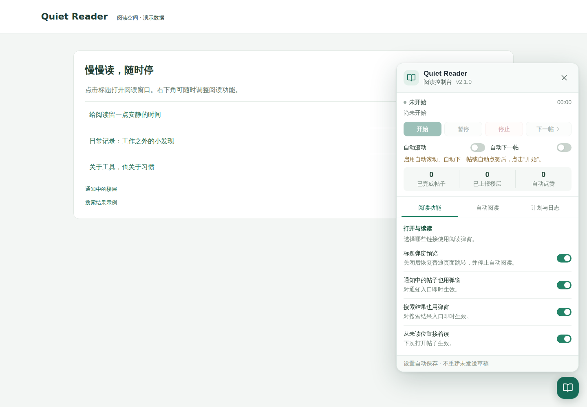

# Quiet Reader

一个可以按需开关功能的阅读辅助脚本。用弹窗查看话题，在控制台调整显示、阅读节奏和连续浏览行为。

[安装脚本](https://raw.githubusercontent.com/kite8/quiet-reader/main/dist/quiet-reader.user.js) · [更新记录](CHANGELOG.md) · [反馈问题](https://github.com/kite8/quiet-reader/issues)

## 安装

1. 浏览器中安装并启用 Tampermonkey。
2. 暂停已有的同类阅读脚本，避免重复拦截点击和重复执行动作。
3. 点击上方 **安装脚本**，在 Tampermonkey 页面确认安装。
4. 刷新适用的页面，点击右下角的书本按钮打开 **阅读控制台**。

如果浏览器把脚本显示为纯文本，可以在 Tampermonkey 的“实用工具 → 从 URL 安装”中粘贴安装地址。第一次需要安装，后续由脚本管理器按其更新检查设置获取新版本。

## 控制台



顶部始终显示 **开始、暂停 / 继续、停止、下一帖**，以及自动滚动、自动下一帖两个快捷开关。面板分为三个标签页：

| 标签页 | 可以调整的内容 |
| --- | --- |
| 阅读功能 | 标题弹窗、通知与搜索入口、未读续读、楼中楼、原图灯箱、用户资料卡、公式、视频、剧透遮罩、楼层导航、工具栏、点赞、回复、Boost、收藏、投票、已读进度 |
| 自动阅读 | 阅读速度、节奏变化、后台与手动接管暂停、帖子来源、帖子数量与时长上限、每帖楼层与停留上限、可选自动点赞 |
| 计划与日志 | 每日开始时间、定时开关、运行日志、恢复默认设置 |

设置会自动保存在当前浏览器。更新脚本后沿用设置；清除站点数据、更换浏览器或使用新的浏览器配置文件会使用各自独立的设置。

## 开始连续阅读

1. 打开一个话题列表，或者先打开希望阅读的话题弹窗。
2. 在控制台开启 **自动滚动**。
3. 如果希望读完后继续，开启 **自动下一帖**。
4. 根据需要选择帖子来源、速度和上限，然后点击 **开始**。

自动浏览在阅读弹窗内完成。默认最多处理 20 个帖子、本轮 30 分钟、单帖 180 秒；每帖楼层上限为 0，表示不单独限制。达到单帖时长或楼层上限也会结束当前帖，因此“已完成帖子”代表本轮已处理的帖子，不保证每一楼都被阅读。

| 行为 | 初始设置 |
| --- | --- |
| 常规阅读增强 | 开启，可逐项关闭 |
| 自动滚动、自动下一帖 | 关闭，需开启后点击“开始” |
| 自动点赞 | 关闭；另有概率、主帖范围和数量上限 |
| 定时启动 | 关闭 |
| 切到后台暂停、手动操作时暂停 | 开启 |

只开启自动下一帖时，可以自行滚动，到达末尾后再自动换帖。只开启自动点赞时，也不会自动替你滚动。点赞数量不会阻止一轮阅读结束。

**暂停**保留本轮位置和队列；**停止**结束本轮，但不修改每日计划开关。关闭定时启动只关闭计划。切回前台仅恢复由“进入后台”触发的暂停，不会恢复手动暂停或已停止的任务。

每天的计划只在页面保持打开时检查，使用浏览器本地时间；错过两分钟不会补跑，也不会在关机或关闭页面后运行。手动开始也会占用当天的计划次数，防止重复启动。

## 开关的生效时机

- 显示与互动开关、滚动、换帖、速度和上限即时生效；已经发出的网络请求可能仍会返回。
- 关闭标题弹窗后，后续链接恢复普通打开方式；已有弹窗保留到你关闭，以保留未发送内容。
- 楼中楼开关调整当前排版；自动模式始终按楼层升序浏览。需要重新获取树形结构时，重新打开普通阅读弹窗。
- 续读和投票的内容构建设置在下次打开时完整应用。当前已打开的投票关闭后不能继续操作。
- 有未发送的回复或 Boost 时，换帖会停止并提示先处理草稿。
- 已读进度来自可见内容的停留时间与服务器成功响应。关闭该开关后不再发起新的进度上报。

## 自动更新

安装地址固定为：

```text
https://raw.githubusercontent.com/kite8/quiet-reader/main/dist/quiet-reader.user.js
```

脚本头部配置了 `@updateURL`、`@downloadURL` 和 `@version`。Tampermonkey 检查到更高版本后，从同一仓库下载新文件；具体检查时间由你的脚本管理器设置决定，无需逐次复制源码。

请保留脚本管理器中的更新检查，不要把地址改回其他脚本的更新源。公开仓库的安装和更新文件无需访问令牌。

## 维护与发布

源代码在 `src/`，版本号以根目录 `VERSION` 为准。修改功能后：

1. 修改相应源码，并提高 `VERSION`，例如从 `2.1.0` 改为 `2.1.1`。
2. 更新 `CHANGELOG.md`，把变更提交到 `main`。
3. **Build and verify** 工作流自动构建、检查语法并运行模拟浏览器测试。
4. 全部通过后，工作流将 `dist/`、预览图和测试记录提交回仓库，固定安装地址随之更新。

未提高版本号时，即使源码有变化，脚本管理器也可能不会触发更新。工作流失败时不会发布新的构建文件；可在 Actions 查看原因。也可在 Actions 中手动运行工作流。

本地构建与验证：

```bash
python3 build.py
node --check dist/quiet-reader.user.js
python3 build.py --check
python3 -m pip install -r tests/requirements.txt
python3 -m playwright install chromium
python3 tests/browser_smoke.py
```

测试使用拦截后的模拟接口，不访问真实账户，不提交真实回复或点赞。浏览器测试覆盖开关、设置保存、草稿保留、滚动与换帖、暂停停止、加载失败、已读跟踪、后台暂停和定时启动。真实页面更新后仍可能需要调整接口或选择器。

源码沿用 MIT 许可，原始版权和来源信息见 [LICENSE](LICENSE) 与 [NOTICE](NOTICE)。
